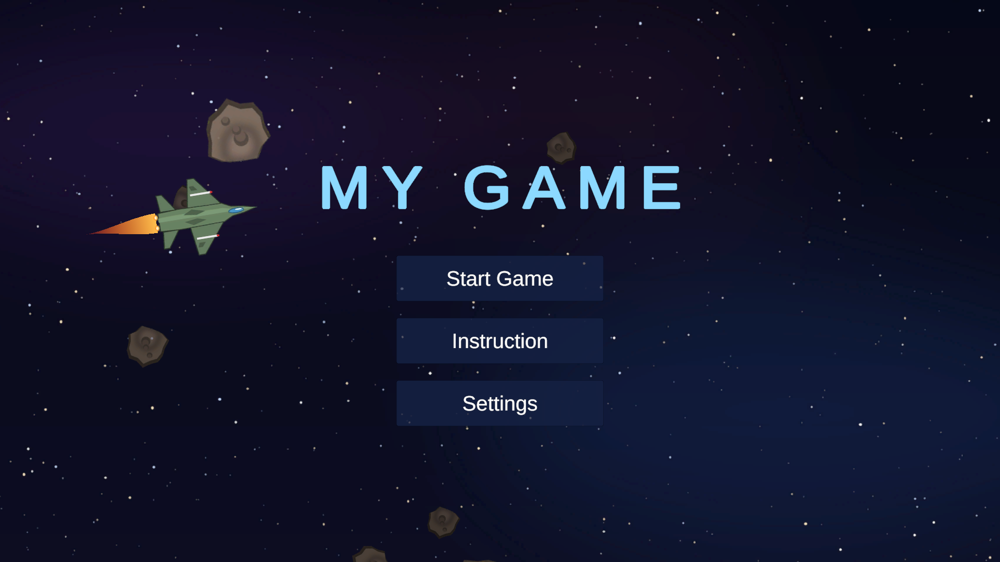
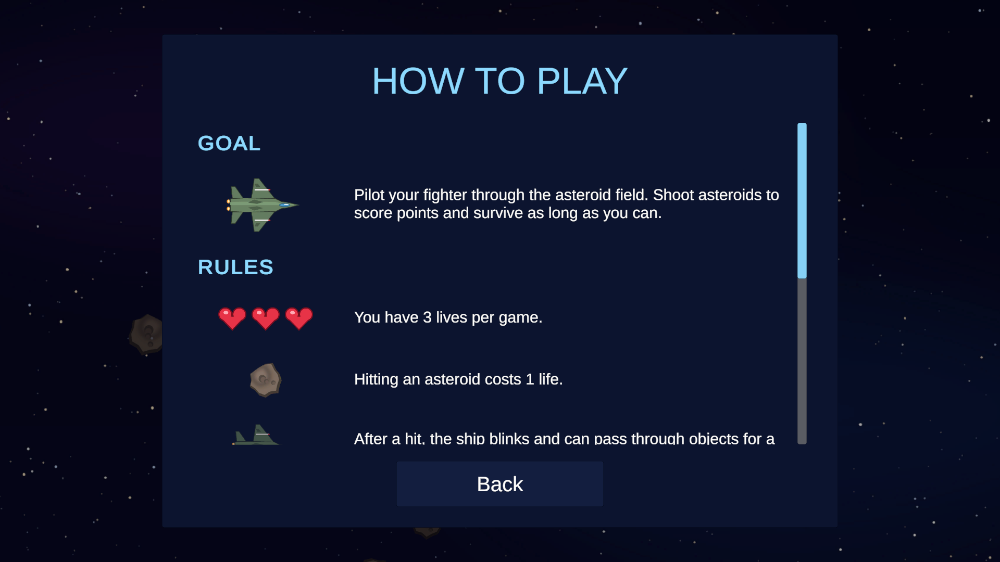
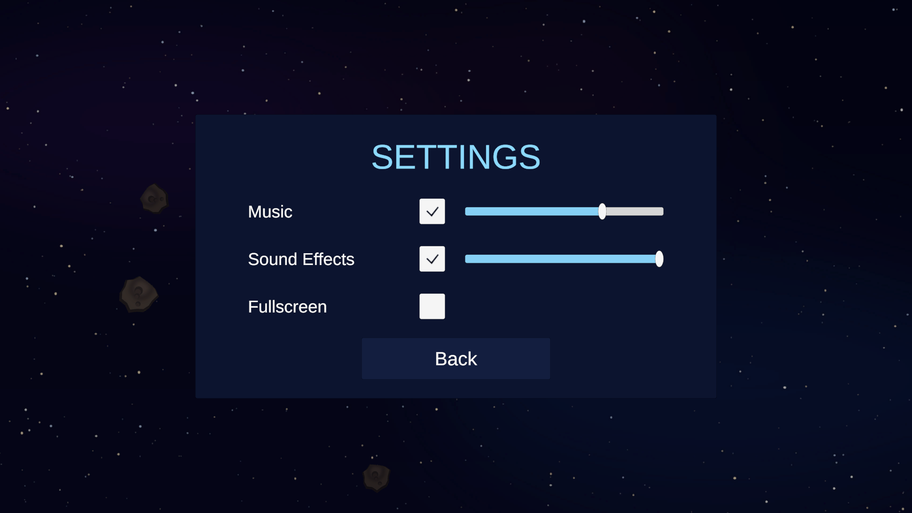
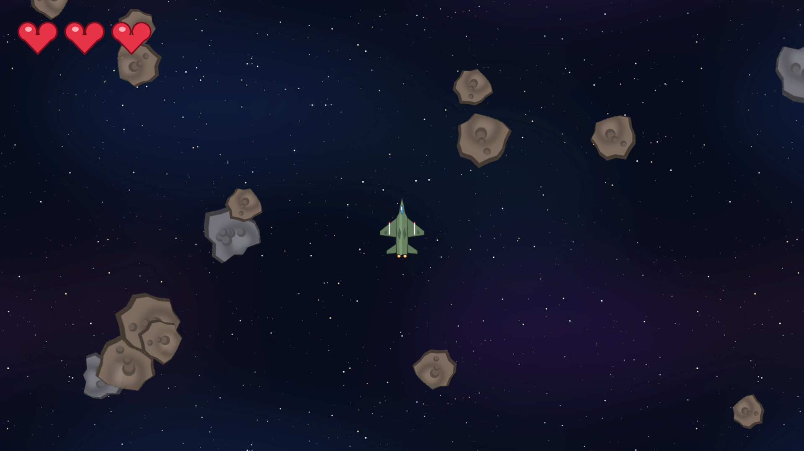
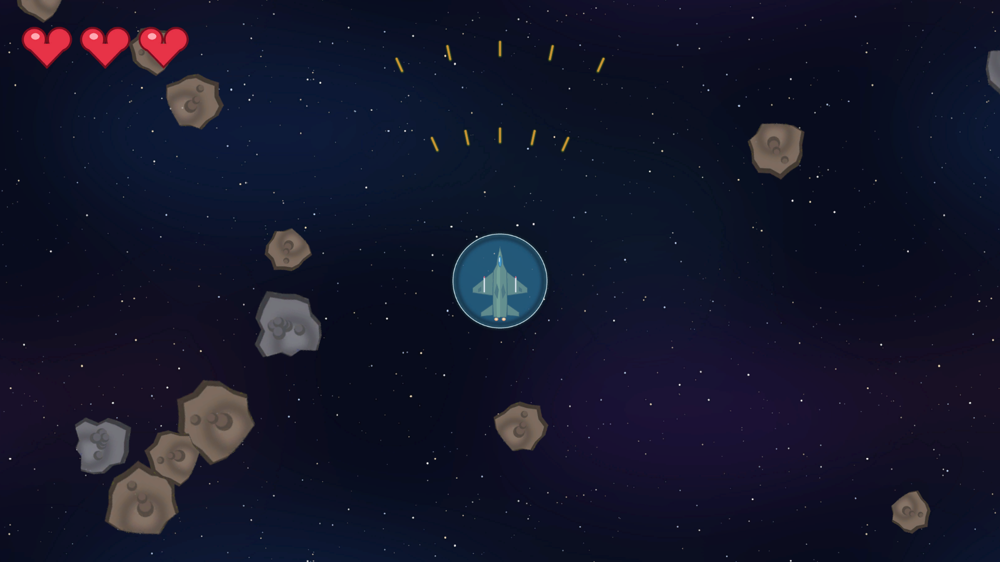
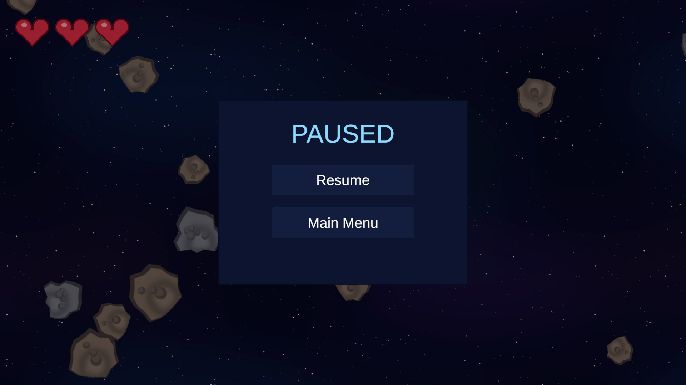
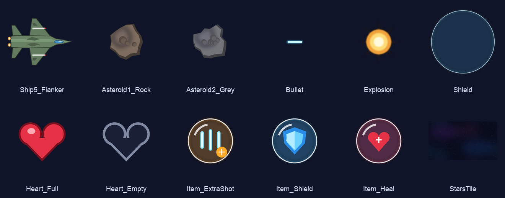

# MY GAME – Space Shooter 2D

Game bắn thiên thạch 2D làm bằng Unity: lái tàu bay giữa bãi thiên thạch vô tận, bắn vỡ đá, nhặt vật phẩm để nâng cấp súng, bật khiên và hồi máu.

## Yêu cầu & cách chạy

- **Unity 6000.0.56f1** (Unity 6), Universal Render Pipeline 2D, Input System.
1. Mở thư mục dự án bằng Unity Hub.
2. Bấm **Play**: game luôn bắt đầu từ `MainMenu`, dù đang mở scene nào (xem `Assets/Editor/PlayFromMainMenu.cs`).
3. Muốn build: **File → Build Profiles**, thêm 2 scene `MainMenu` và `Game` (theo thứ tự này).

## Điều khiển

| Phím | Hành động |
|---|---|
| **W / S** | Tiến / lùi |
| **A / D** | Xoay trái / phải |
| **Space** | Bắn (giữ để bắn liên tục) |
| **Shift** (+ W/A/S/D) | Lướt né theo hướng đang giữ (không giữ hướng nào thì lướt về phía trước) |
| **ESC** | Tạm dừng / tiếp tục |

## Các màn hình

### Main Menu
Menu chính có tàu bay ngang qua nền. Từ đây vào **Start Game**, **Instruction** hoặc **Settings**.

| Hướng dẫn | Cài đặt |
|---|---|
|  |  |

**Settings** chỉnh bật/tắt và âm lượng của nhạc nền và hiệu ứng âm thanh, cùng chế độ toàn màn hình. Cài đặt được lưu lại (PlayerPrefs).

### Màn chơi

- 3 mạng (trái tim góc trên bên trái). Va vào thiên thạch thì mất 1 mạng và tàu nhấp nháy bất tử trong 2 giây. Hết mạng thì quay về menu.
- **Thiên thạch nâu** vỡ sau 1 phát bắn.
- **Thiên thạch xám** (đặc biệt) cần 3 phát và rơi ra 1–2 vật phẩm.
- Thiên thạch bị phá sẽ xuất hiện lại ngoài màn hình, nên bãi đá không bao giờ hết.

### Vật phẩm & nâng cấp

| Vật phẩm | Tác dụng |
|---|---|
| **ExtraShot** | Nâng súng: 1 → 2 → 3 tia → bắn xoè hình chữ V, sát thương x2 (đạn màu cam) |
| **Shield** | Khiên chặn được 1 lần va chạm |
| **Heal** | Hồi 1 mạng |

Vật phẩm trôi chậm, nhấp nháy trước khi biến mất (sau 12 giây).

### Tạm dừng

## Assets

### Hình ảnh (`Assets/Sprites`)

### Âm thanh (`Assets/Resources/Audio`)
Toàn bộ âm thanh đều là **CC0** (public domain), dùng tự do kể cả mục đích thương mại. Nguồn chi tiết xem trong `Assets/Resources/Audio/CREDITS.txt`.

| File | Dùng cho | Nguồn |
|---|---|---|
| `MenuMusic.ogg` | Nhạc menu | [Another space background track](https://opengameart.org/content/another-space-background-track) – yd |
| `GameMusic.ogg` | Nhạc màn chơi | [Fast Fight Battle Music (looped)](https://opengameart.org/content/fast-fight-battle-music-looped) – Ville Nousiainen |
| `Engine.ogg` | Tiếng động cơ (to hơn khi tăng tốc) | [Kenney Sci-Fi Sounds](https://kenney.nl/assets/sci-fi-sounds) |
| `Shoot.ogg` | Bắn | Kenney Sci-Fi Sounds |
| `Hit.ogg`, `Explosion.ogg` | Trúng đá / đá nổ | Kenney Sci-Fi Sounds |
| `ShieldBreak.ogg`, `PlayerHurt.ogg` | Khiên vỡ / mất mạng | Kenney Sci-Fi Sounds |
| `Pickup.ogg` | Nhặt vật phẩm | [Kenney Digital Audio](https://kenney.nl/assets/digital-audio) |

Muốn đổi âm thanh: thay file trong `Assets/Resources/Audio` và giữ nguyên tên.

## Cấu trúc code

| File | Vai trò |
|---|---|
| `Scripts/PlayerShip.cs` | Điều khiển tàu, bắn, lướt, máu, khiên, nâng cấp súng, tiếng động cơ |
| `Scripts/Asteroid.cs`, `Drift.cs` | Máu và nổ của thiên thạch, rơi vật phẩm, trôi và xuất hiện lại |
| `Scripts/Bullet.cs`, `Explosion.cs`, `Pickup.cs` | Đạn, hiệu ứng nổ, vật phẩm |
| `Scripts/GameAudio.cs` | Nhạc nền theo scene và hiệu ứng âm thanh (tự khởi tạo, không cần gắn vào scene) |
| `Scripts/MainMenu.cs`, `SettingsMenu.cs`, `PauseMenu.cs` | Menu chính, cài đặt, tạm dừng |
| `Scripts/CameraFollow.cs`, `Starfield.cs`, `ShipFlyBy.cs` | Camera bám tàu, nền sao parallax, tàu bay ngang ở menu |
| `Editor/MainMenuBuilder.cs`, `GameBuilder.cs` | Tạo lại scene: **Tools → Build Main Menu / Build Game Scene** |
